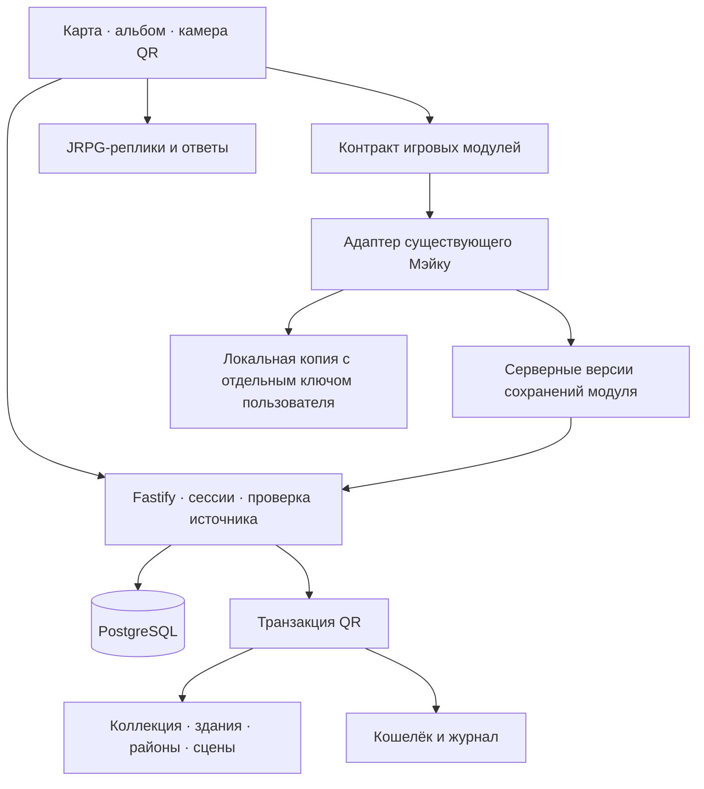

# Прямогород · этап 1

## Исходный проект

React 19, TypeScript 5, Vite 7 и Zustand 5. Серверной части ранее не было. Мэйку использует конечный автомат, единое время движения, покадровые PNG, локальные сохранения с Web Locks и автономные сценки. Эти механизмы сохранены в самостоятельном игровом экране src/modules/meiku/MeikuGame.tsx. Новый движок для текущих задач не требуется.

## Компоненты

World System получает доступность зданий с сервера. Карта не открывает здания по клиентским флагам. У нового пользователя 16 закрытых зданий. При первом QR сервер одновременно записывает первое здание, коллекцию, район и индивидуальную сцену intro. У следующего впервые открытого бренда создаётся meeting. Повторный дизайн не создаёт новую сцену.

Story System хранит граф реплик и вариантов ответов. Пользователь выбирает путь, сервер проверяет его достижимость от start до конечного узла и фиксирует завершение. Событие завершения обновляет клиентский снимок. Учебные реплики помечены временными. У каждого бренда собственные ID и имя говорящего. Универсального стартового героя нет.

Collection System содержит 256 дизайнов, связь с брендом, номер в коллекции и необязательный путь к PNG. Данные названы точно по таблице, включая регистр. Изображения из художественных папок не копировались и не изменялись. При отсутствии готового пути карточка показывает номер и название.

## Транзакция QR

Сервер хранит SHA-256 от случайного 256-битного токена. Префикс pg1_ идентифицирует формат, полный токен передаётся только владельцу тестового QR. В ссылке он находится во фрагменте, который не отправляется в access log веб-сервера.

Погашение блокирует строку пользователя, затем строку токена. Проверки использованности и срока выполняются внутри транзакции. Ограничение UNIQUE(token_id) в активациях дополнительно защищает от повторов. Коллекция имеет ключ user_id + design_id. Новый действительный токен повторного дизайна начисляет серверную награду. Сумма, источник и активация заносятся в coin_ledger в той же транзакции. Повтор использованного QR возвращает 409.

Эффекты каталога поддерживают collect, coins и moduleEvent. Последний создаёт долговечное событие для модуля. Сейчас в исходной таблице численные эффекты не заданы, поэтому 256 импортированных дизайнов имеют эффект collect. Конкретные игровые реакции на moduleEvent должны добавляться в обработчиках соответствующих модулей.

## Сессии и данные

Пользователь получает гостевую серверную учётную запись и HttpOnly-cookie на 30 дней. Cookie SameSite=Strict, а изменяющие API проверяют Origin. В БД находится хеш сессионного секрета. Повторное открытие с действующей cookie возвращает прежнего пользователя.

Пароли, восстановление учётной записи и перенос входа на другое устройство пока не реализованы. При удалении cookie для повторного доступа к той же учётной записи понадобится будущий механизм входа. Dev-сброс создаёт новую тестовую учётную запись, сохраняя старые строки в БД.

module_saves использует номер версии. Запись с устаревшей revision отклоняется с 409. Сервер не выдаёт доступ к сохранению закрытого здания. Модуль Мэйку сохраняет локальную копию и автоматически отправляет прогресс на сервер с небольшой задержкой. Перед принудительной загрузкой серверной версии сохраняется локальная резервная копия.

Старый ключ meiku-world остаётся в браузере. При первом входе в дом после открытия MeikuNeko адаптер копирует его в ключ pryamogorod:meiku:<userId>, создаёт серверное сохранение и отдельную запись legacy_imports. Повторный импорт не перезаписывает первоначальный снимок.

Кошелёк Мэйку и городской кошелёк разделены на этом этапе. Существующая логика наград и тестовый баланс Мэйку продолжают работать в модуле. Произвольный локальный баланс не зачисляется в авторитетный городской кошелёк. Полная серверная авторизация действий самого тамагочи — отдельный последующий этап. Это совместимый адаптер, его JSON-состояние остаётся клиентским.

## Каталог и временные решения

Источник — Google Sheets, вкладки «Персонажи» A1:H17 и «Стикеры» A1:Q18. В проверенных диапазонах A1:P35 листа «Локации» и A1:P30 листа «Игры» содержимого не обнаружено. В колонках «Район» и «Дом» реестра персонажей значений нет.

Поэтому районы 1–4, названия «Здание <бренд>» и группировка по четырём строкам реестра — технические макеты. ID сформированы из бренда и номера дизайна, поскольку отдельные утверждённые ID в таблице отсутствуют. Они стабильны в server/content/catalog.json и не должны изменяться после выпуска токенов без миграции.

Каталог можно импортировать из JSON через npm run catalog:import -- <file> или dev-интерфейс. Проверяются 4 района, 16 брендов, 256 дизайнов, уникальность ID, слоты, ссылки и эффекты. Импорт атомарный. Для добавления PNG используются пути /assets/. У исходников художника свой жизненный цикл, каркас их не меняет.

## Защита dev-режима

Dev API регистрируется только при NODE_ENV, отличном от production, и DEV_TOOLS=true. В production маршруты выпуска тестовых QR, новой тестовой игры и импорта отсутствуют. Тестовые токены нельзя погашать production-сервером. UI инструментов исключается условием import.meta.env.DEV и дополнительно проверяет серверный флаг.

## Следующие шаги

1. Утвердить районы, здания, их ID и распределение брендов.
2. Подготовить полноценные сценарии и графику портретов.
3. Утвердить эффекты стикеров и баланс повторных дизайнов.
4. Реализовать безопасный вход и восстановление аккаунта.
5. Авторизовать экономику игровых модулей на сервере, согласовать миграцию кошелька Мэйку.
6. Реализовывать остальные 15 механик по одной через общий модульный контракт.
7. Проверить физическую камеру QR на смартфонах и добавить совместимый декодер там, где BarcodeDetector отсутствует.
8. Перед внешним размещением настроить HTTPS, секреты окружения, резервные копии и роль PostgreSQL с нужным минимумом прав.
